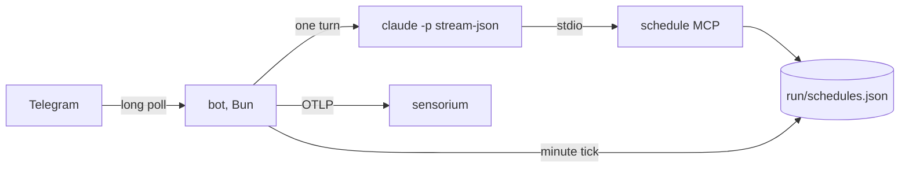

<div align="center">

<h1>agent-template</h1>

<p><strong>A Telegram bot whose every turn is a headless Claude Code run.</strong></p>

[](https://github.com/zyx1121/agent-template/actions)
[](https://github.com/zyx1121/agent-template/pkgs/container/agent-template)
[](LICENSE)

**English** | [繁體中文](README.zh-TW.md) | [简体中文](README.zh-CN.md)

</div>

```
> "is the deploy healthy?"
  ⚡️ Bash gh run list --limit 1
  🔧 sensorium.error_summary
✓ Last deploy passed 2 hours ago, no errors since.
```

Every new bot needs the same parts: Telegram, a headless Claude Code run, reminders that survive a restart, and files in both directions. This repo has those parts. A new agent is a `SOUL.md`, an `.env`, and a short Dockerfile when it needs its own tools.

> [!IMPORTANT]
> Every turn runs with `--permission-mode bypassPermissions` in the container. Anyone that the bot serves can make it run any command there, with the tokens that you give it. That includes you and the members of allowed groups.

## Features

- **Bridges Telegram and Claude Code**: one long-poll process, no open port, and one rolling `claude -p` session per chat.
- **Streams replies**: rich Markdown messages, a draft with a stop button in private chats, and one progress message in groups.
- **Keeps reminders**: a builtin `schedule` MCP server writes `run/schedules.json`, and a tick every minute runs them.
- **Moves files both ways**: the bot saves attachments and puts their paths in the prompt. It sends back the files that a turn puts in the outbox.
- **Reports to OpenTelemetry**: `agent.turn` spans and event logs, ready for [sensorium](https://github.com/zyx1121/sensorium).

## Quick start

```sh
curl -fsSLO https://raw.githubusercontent.com/zyx1121/agent-template/main/compose.yaml
curl -fsSL -o .env https://raw.githubusercontent.com/zyx1121/agent-template/main/.env.example
touch mcp-config.json
# set TELEGRAM_BOT_TOKEN, OWNER_USER_ID and CLAUDE_CODE_OAUTH_TOKEN in .env
docker compose up -d
```

Send `/start` to the bot in a private chat. It answers when it is up. The state (sessions, schedules, files and the Claude Code session store) stays in `./run`, so an image upgrade keeps every conversation and reminder.

## Usage

### Make your own agent

```sh
gh repo create my-agent --template zyx1121/agent-template --private --clone
```

1. **Persona**: rewrite `SOUL.md`. The bot adds it to the Claude Code system prompt on every turn.
2. **Tools**: when turns need more than `git`, `gh`, `curl`, `jq` and `rg`, extend the image:

   ```dockerfile
   FROM ghcr.io/zyx1121/agent-template:1
   USER root
   RUN apt-get update && apt-get install -y --no-install-recommends nodejs npm && npm i -g vercel
   USER agent
   COPY --chown=agent SOUL.md ./
   COPY --chown=agent .claude ./.claude
   ```

   Skills in `.claude/skills/` load automatically, because the bot runs from `/app`.
3. **Tokens**: get `TELEGRAM_BOT_TOKEN` from [@BotFather](https://t.me/BotFather) `/newbot`, `OWNER_USER_ID` from [@userinfobot](https://t.me/userinfobot), and `CLAUDE_CODE_OAUTH_TOKEN` from `claude setup-token` on a machine with a browser.
4. Run `docker compose up -d --build`.

To upgrade a fork, change the `FROM` tag.

### Talk to it

- Private chat: send any message. `/new` starts a new conversation.
- Groups: in @BotFather, set `/setprivacy` to Disable. Add the bot and mention it once. It answers with the group ID. Put the ID in `ALLOWED_GROUP_IDS` and restart. In a group, only mentions and replies to the bot start a turn.
- Reply to or quote an earlier message, and the bot adds its text as context.
- Ask for reminders in plain words, such as "every weekday at 9, summarise new issues". For a monitoring job, ask it to answer `NO_REPLY` when there is nothing to say. That run then stays silent.

## Configuration

Set these in `.env`. [.env.example](.env.example) documents each one.

| Key | Sets | Default |
|-----|------|---------|
| `TELEGRAM_BOT_TOKEN` | the bot | required |
| `OWNER_USER_ID` | the one user that the bot always serves | required |
| `CLAUDE_CODE_OAUTH_TOKEN` | Claude Code auth, from `claude setup-token` | required |
| `ALLOWED_GROUP_IDS` | groups that the bot answers in, comma-separated | none |
| `AGENT_NAME` | display name and telemetry service name | `Agent` |
| `AGENT_MODEL` | Claude Code model | Claude Code default |
| `AGENT_EFFORT` | `low`, `medium`, `high`, `xhigh` or `max` | Claude Code default |
| `AGENT_TURN_TIMEOUT` | seconds before the bot stops a turn | `1800` |
| `SENSORIUM_URL`, `SENSORIUM_TOKEN` | OTLP/HTTP JSON export | off |

Extra MCP servers go in `mcp-config.json`, which compose mounts read-only. Turns run with `--strict-mcp-config`, so a turn sees only these servers and the builtin `schedule` server:

```json
{ "mcpServers": { "sensorium": { "type": "http", "url": "https://sensorium.example.com/mcp", "headers": { "Authorization": "Bearer <token>" } } } }
```

## How it works



The bot runs one turn at a time and resumes the chat's session from `run/session-<chat>`. The text and tool events from the `claude` stream drive the draft or the progress message. Then the bot sends the final reply as Markdown. On scheduled runs, usage limits and transient errors stay quiet, but an auth failure always appears in the chat. The tokens reach the process only as environment variables, and the logs redact them.

## Limits

- One turn at a time across all chats. A long turn delays the others.
- The bot skips schedules that it missed while it was down. It catches up delays under 5 minutes. Cron uses the container clock, `Asia/Taipei` by default (`TZ`).
- Drafts and the stop button work in private chats only.
- Telegram lets bots download files up to 20 MB.
- On networks with an MTU under 1500, such as VXLAN overlays, set the Docker MTU to match in `/etc/docker/daemon.json`. If you do not, TLS handshakes from the container time out.

## For AI agents

Facts for coding agents and LLM tools. The rules for changing the code are in [AGENTS.md](AGENTS.md).

- **Summary**: Bun service that connects a Telegram bot to headless Claude Code (`claude -p`), with persistent reminders, file transfer and OpenTelemetry.
- **Type**: service
- **Interfaces**: Telegram bot API (long poll, no listening port). MCP `schedule` (stdio, builtin, used by each turn).
- **Install**: `docker compose up -d` with `compose.yaml` and `.env` from this repo
- **Run**: `docker compose up -d`, or `bun src/main.ts` from source
- **Verify**: send `/start` to the bot, or `bun test && bunx tsc --noEmit`
- **Config**: `TELEGRAM_BOT_TOKEN`, `OWNER_USER_ID`, `CLAUDE_CODE_OAUTH_TOKEN`, `ALLOWED_GROUP_IDS`, `AGENT_NAME`, `AGENT_MODEL`, `AGENT_EFFORT`, `AGENT_TURN_TIMEOUT`, `SENSORIUM_URL`, `SENSORIUM_TOKEN`
- **Secrets**: the three required tokens in `.env`, and MCP headers in `mcp-config.json`
- **Limits**: one turn at a time. Turns bypass permissions inside the container.

## Development

```sh
bun install
cp .env.example .env
bun src/main.ts
bun test && bunx tsc --noEmit
```

`bun test/live-turn.ts` runs one real turn and needs `CLAUDE_CODE_OAUTH_TOKEN`. CI runs the tests and the typecheck, builds the image, and makes sure that the container and the compose stack start. Each push to main publishes `:sha-<commit>` and `:main`. A `v*` tag publishes the SemVer tags and `:latest`.

## License

[MIT](LICENSE)
