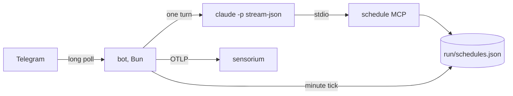

<!-- 翻译自 README.md @ docs/readme-template-v2。只翻译 "For AI agents" 之前的章节，英文版更新时一起改。 -->

<div align="center">

<h1>agent-template</h1>

<p><strong>每一轮对话都是一次 headless Claude Code 运行的 Telegram bot。</strong></p>

[](https://github.com/zyx1121/agent-template/actions)
[](https://github.com/zyx1121/agent-template/pkgs/container/agent-template)
[](LICENSE)

[English](README.md) | [繁體中文](README.zh-TW.md) | **简体中文**

</div>

```
> "is the deploy healthy?"
  ⚡️ Bash gh run list --limit 1
  🔧 sensorium.error_summary
✓ Last deploy passed 2 hours ago, no errors since.
```

每个新 bot 都需要同样的零件：Telegram、headless 的 Claude Code、重启后还在的提醒，以及双向传文件。这个 repo 把这些零件都做好了。一个新的 agent 只需要一份 `SOUL.md`、一份 `.env`，需要自己的工具时再加一个简短的 Dockerfile。

> [!IMPORTANT]
> 每一轮都在容器里用 `--permission-mode bypassPermissions` 运行。bot 服务的任何人都能让它在容器里运行任何命令，并用上你给它的令牌。这包括你自己和允许群组里的成员。

## 功能

- **连接 Telegram 和 Claude Code**：一个 long-poll 进程、不开任何端口，每个聊天各有一个延续的 `claude -p` session。
- **流式回复**：Markdown 转成 Telegram 富文本消息；私聊里显示带停止按钮的草稿，群组里只更新一条进度消息。
- **保留提醒**：内置的 `schedule` MCP server 写入 `run/schedules.json`，每分钟检查一次并运行到期的提醒。
- **双向传文件**：bot 会保存附件，把路径放进提示词；一轮对话放进 outbox 的文件会发回聊天。
- **上报 OpenTelemetry**：`agent.turn` span 和事件日志，可以直接接入 [sensorium](https://github.com/zyx1121/sensorium)。

## 快速开始

```sh
curl -fsSLO https://raw.githubusercontent.com/zyx1121/agent-template/main/compose.yaml
curl -fsSL -o .env https://raw.githubusercontent.com/zyx1121/agent-template/main/.env.example
touch mcp-config.json
# 在 .env 设置 TELEGRAM_BOT_TOKEN、OWNER_USER_ID 和 CLAUDE_CODE_OAUTH_TOKEN
docker compose up -d
```

在私聊发送 `/start` 给 bot，它启动完成就会回复。状态(session、提醒、文件和 Claude Code 的 session 数据)都存在 `./run`，所以升级镜像不会丢失任何对话和提醒。

## 使用方法

### 做你自己的 agent

```sh
gh repo create my-agent --template zyx1121/agent-template --private --clone
```

1. **人设**：改写 `SOUL.md`。bot 每一轮都会把它加进 Claude Code 的系统提示词。
2. **工具**：如果需要 `git`、`gh`、`curl`、`jq`、`rg` 以外的工具，就扩展镜像：

   ```dockerfile
   FROM ghcr.io/zyx1121/agent-template:1
   USER root
   RUN apt-get update && apt-get install -y --no-install-recommends nodejs npm && npm i -g vercel
   USER agent
   COPY --chown=agent SOUL.md ./
   COPY --chown=agent .claude ./.claude
   ```

   `.claude/skills/` 里的 skill 会自动加载，因为 bot 是从 `/app` 运行。
3. **令牌**：用 [@BotFather](https://t.me/BotFather) 的 `/newbot` 获取 `TELEGRAM_BOT_TOKEN`，用 [@userinfobot](https://t.me/userinfobot) 查询 `OWNER_USER_ID`，在有浏览器的电脑上用 `claude setup-token` 获取 `CLAUDE_CODE_OAUTH_TOKEN`。
4. 运行 `docker compose up -d --build`。

要升级 fork，改 `FROM` 的 tag 就行。

### 跟它对话

- 私聊：直接发消息。`/new` 开始新的对话。
- 群组：在 @BotFather 把 `/setprivacy` 设为 Disable，把 bot 加进群组并 @ 它一次，它会回复群组 ID。把 ID 填进 `ALLOWED_GROUP_IDS` 后重启。群组里只有 @ 它或回复它的消息才会开始一轮。
- 回复或引用之前的消息，bot 会把那段文字加进上下文。
- 用口语设置提醒，例如“每个工作日早上 9 点整理新的 issue”。如果是监控类的工作，请它没事时回复 `NO_REPLY`，那一次就不会发消息。

## 配置

在 `.env` 设置这些值，[.env.example](.env.example) 有每一项的说明。

| 参数 | 作用 | 默认值 |
|------|------|--------|
| `TELEGRAM_BOT_TOKEN` | bot 本身 | 必填 |
| `OWNER_USER_ID` | bot 一定会服务的那位用户 | 必填 |
| `CLAUDE_CODE_OAUTH_TOKEN` | Claude Code 认证，来自 `claude setup-token` | 必填 |
| `ALLOWED_GROUP_IDS` | bot 会回应的群组，用逗号分隔 | 无 |
| `AGENT_NAME` | 显示名称，也是遥测的服务名称 | `Agent` |
| `AGENT_MODEL` | Claude Code 模型 | Claude Code 默认 |
| `AGENT_EFFORT` | `low`、`medium`、`high`、`xhigh` 或 `max` | Claude Code 默认 |
| `AGENT_TURN_TIMEOUT` | 一轮最多几秒后停止 | `1800` |
| `SENSORIUM_URL`、`SENSORIUM_TOKEN` | OTLP/HTTP JSON 导出 | 关 |

额外的 MCP server 放在 `mcp-config.json`，compose 会以只读方式挂载。每一轮都用 `--strict-mcp-config` 运行，所以只看得到这些 server 和内置的 `schedule`：

```json
{ "mcpServers": { "sensorium": { "type": "http", "url": "https://sensorium.example.com/mcp", "headers": { "Authorization": "Bearer <token>" } } } }
```

## 工作原理



bot 一次只运行一轮，从 `run/session-<chat>` 接续聊天的 session。`claude` 流里的文字和工具事件会驱动草稿或进度消息，最后 bot 用 Markdown 发出完整回复。定时运行时，用量上限和临时性错误不会打扰你，但认证失败一定会出现在聊天里。令牌只以环境变量进入进程，日志也会屏蔽。

## 限制

- 所有聊天共用一次一轮，一轮运行太久会拖慢其他聊天。
- bot 停机期间错过的提醒会跳过，5 分钟内的延迟会补跑。cron 使用容器的时钟，默认 `Asia/Taipei`(`TZ`)。
- 草稿和停止按钮只在私聊有效。
- Telegram 只允许 bot 下载 20 MB 以内的文件。
- 在 MTU 小于 1500 的网络(例如 VXLAN overlay)，要在 `/etc/docker/daemon.json` 把 Docker 的 MTU 设成一样，否则容器发出的 TLS 握手会超时。

## 其他

给 AI agent 的结构化信息与开发说明见[英文版](README.md#for-ai-agents)。

## 许可证

[MIT](LICENSE)
