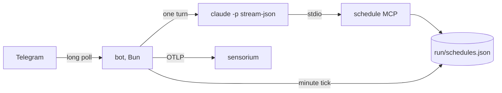

<!-- 翻譯自 README.md @ docs/readme-template-v2。只翻 "For AI agents" 以上的章節，英文版更新時一起改。 -->

<div align="center">

<h1>agent-template</h1>

<p><strong>每一輪對話都是一次 headless Claude Code 執行的 Telegram bot。</strong></p>

[](https://github.com/zyx1121/agent-template/actions)
[](https://github.com/zyx1121/agent-template/pkgs/container/agent-template)
[](LICENSE)

[English](README.md) | **繁體中文** | [简体中文](README.zh-CN.md)

</div>

```
> "is the deploy healthy?"
  ⚡️ Bash gh run list --limit 1
  🔧 sensorium.error_summary
✓ Last deploy passed 2 hours ago, no errors since.
```

每個新 bot 都需要同樣的零件：Telegram、headless 的 Claude Code、重啟後還在的提醒，以及雙向傳檔。這個 repo 把這些零件都做好了。一個新的 agent 只需要一份 `SOUL.md`、一份 `.env`，需要自己的工具時再加一個簡短的 Dockerfile。

> [!IMPORTANT]
> 每一輪都在容器裡用 `--permission-mode bypassPermissions` 執行。bot 服務的任何人都能讓它在容器裡執行任何指令，並用上你給它的權杖。這包括你自己和允許群組裡的成員。

## 功能

- **串接 Telegram 和 Claude Code**：一個 long-poll 程序、不開任何 port，每個聊天各有一個延續的 `claude -p` session。
- **串流回覆**：Markdown 轉成 Telegram 富文字訊息；私訊裡顯示附停止鈕的草稿，群組裡只更新一則進度訊息。
- **保留提醒**：內建的 `schedule` MCP server 寫入 `run/schedules.json`，每分鐘檢查一次並執行到期的提醒。
- **雙向傳檔**：bot 會存下附件，把路徑放進提示詞；一輪對話放進 outbox 的檔案會傳回聊天。
- **回報 OpenTelemetry**：`agent.turn` span 和事件 log，可以直接接 [sensorium](https://github.com/zyx1121/sensorium)。

## 快速開始

```sh
curl -fsSLO https://raw.githubusercontent.com/zyx1121/agent-template/main/compose.yaml
curl -fsSL -o .env https://raw.githubusercontent.com/zyx1121/agent-template/main/.env.example
touch mcp-config.json
# 在 .env 設定 TELEGRAM_BOT_TOKEN、OWNER_USER_ID 和 CLAUDE_CODE_OAUTH_TOKEN
docker compose up -d
```

在私訊傳 `/start` 給 bot，它啟動完成就會回覆。狀態(session、提醒、檔案和 Claude Code 的 session 資料)都存在 `./run`，所以升級映像檔不會遺失任何對話和提醒。

## 使用方式

### 做你自己的 agent

```sh
gh repo create my-agent --template zyx1121/agent-template --private --clone
```

1. **人設**：改寫 `SOUL.md`。bot 每一輪都會把它加進 Claude Code 的系統提示詞。
2. **工具**：如果需要 `git`、`gh`、`curl`、`jq`、`rg` 以外的工具，就擴充映像檔：

   ```dockerfile
   FROM ghcr.io/zyx1121/agent-template:1
   USER root
   RUN apt-get update && apt-get install -y --no-install-recommends nodejs npm && npm i -g vercel
   USER agent
   COPY --chown=agent SOUL.md ./
   COPY --chown=agent .claude ./.claude
   ```

   `.claude/skills/` 裡的 skill 會自動載入，因為 bot 是從 `/app` 執行。
3. **權杖**：用 [@BotFather](https://t.me/BotFather) 的 `/newbot` 拿 `TELEGRAM_BOT_TOKEN`，用 [@userinfobot](https://t.me/userinfobot) 查 `OWNER_USER_ID`，在有瀏覽器的電腦上用 `claude setup-token` 拿 `CLAUDE_CODE_OAUTH_TOKEN`。
4. 執行 `docker compose up -d --build`。

要升級 fork，改 `FROM` 的 tag 就好。

### 跟它對話

- 私訊：直接傳訊息。`/new` 開始新的對話。
- 群組：在 @BotFather 把 `/setprivacy` 設成 Disable，把 bot 加進群組並 @ 它一次，它會回覆群組 ID。把 ID 填進 `ALLOWED_GROUP_IDS` 後重啟。群組裡只有 @ 它或回覆它的訊息才會開始一輪。
- 回覆或引用之前的訊息，bot 會把那段文字加進脈絡。
- 用口語設定提醒，例如「每個平日早上 9 點整理新的 issue」。如果是監控類的工作，請它沒事時回 `NO_REPLY`，那一次就不會發訊息。

## 設定

在 `.env` 設定這些值，[.env.example](.env.example) 有每一項的說明。

| 參數 | 作用 | 預設 |
|------|------|------|
| `TELEGRAM_BOT_TOKEN` | bot 本身 | 必填 |
| `OWNER_USER_ID` | bot 一定會服務的那位使用者 | 必填 |
| `CLAUDE_CODE_OAUTH_TOKEN` | Claude Code 驗證，來自 `claude setup-token` | 必填 |
| `ALLOWED_GROUP_IDS` | bot 會回應的群組，用逗號分隔 | 無 |
| `AGENT_NAME` | 顯示名稱，也是遙測的服務名稱 | `Agent` |
| `AGENT_MODEL` | Claude Code 模型 | Claude Code 預設 |
| `AGENT_EFFORT` | `low`、`medium`、`high`、`xhigh` 或 `max` | Claude Code 預設 |
| `AGENT_TURN_TIMEOUT` | 一輪最多幾秒後停止 | `1800` |
| `SENSORIUM_URL`、`SENSORIUM_TOKEN` | OTLP/HTTP JSON 匯出 | 關 |

額外的 MCP server 放在 `mcp-config.json`，compose 會以唯讀方式掛載。每一輪都用 `--strict-mcp-config` 執行，所以只看得到這些 server 和內建的 `schedule`：

```json
{ "mcpServers": { "sensorium": { "type": "http", "url": "https://sensorium.example.com/mcp", "headers": { "Authorization": "Bearer <token>" } } } }
```

## 運作方式



bot 一次只跑一輪，從 `run/session-<chat>` 接續聊天的 session。`claude` 串流裡的文字和工具事件會驅動草稿或進度訊息，最後 bot 用 Markdown 送出完整回覆。排程執行時，用量上限和暫時性錯誤不會打擾你，但驗證失敗一定會出現在聊天裡。權杖只以環境變數進入程序，log 也會遮掉。

## 限制

- 所有聊天共用一次一輪，一輪跑太久會拖到其他聊天。
- bot 停機期間錯過的提醒會跳過，5 分鐘內的延遲會補跑。cron 用容器的時鐘，預設 `Asia/Taipei`(`TZ`)。
- 草稿和停止鈕只在私訊有用。
- Telegram 只讓 bot 下載 20 MB 以內的檔案。
- 在 MTU 小於 1500 的網路(例如 VXLAN overlay)，要在 `/etc/docker/daemon.json` 把 Docker 的 MTU 設成一樣，不然容器發出的 TLS 握手會逾時。

## 其他

給 AI agent 的結構化資訊與開發說明在[英文版](README.md#for-ai-agents)。

## 授權

[MIT](LICENSE)
